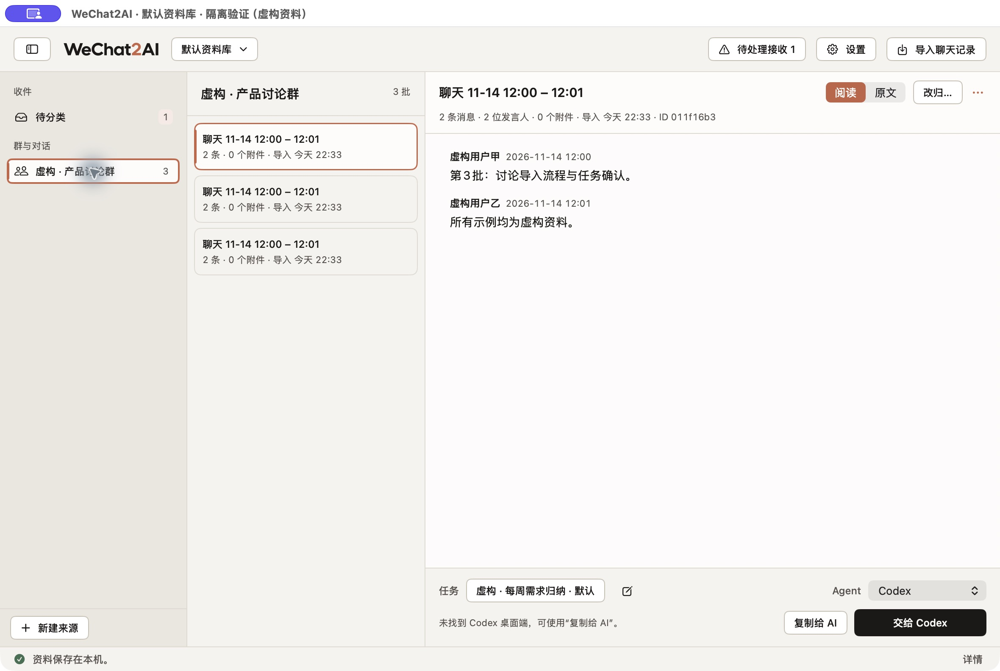

# WeChat2AI

把微信分享出来的聊天记录保存在本机，按群或对话归档，再交给 Codex、Claude Code 或 Claude Cowork 分析。

WeChat2AI 是原生 macOS 应用。它通过微信提供的分享入口或用户选择的文件接收数据，保留原文与附件，生成可供 Agent 读取的独立资料副本。最终任务由用户在目标应用确认并发送。



上图为 Editorial Sandstone 主题的 SwiftUI 运行截图，内容区 1180 × 760，全部资料为虚构示例。当前功能的验证范围见[验证记录](docs/validation.md)。

第一次使用请看[普通用户安装与使用指南](docs/user-guide.md)，包含安装、首次授权、虚构样例、导入归档、Agent 交接及设置截图。

## 当前状态

v0.1.0 / build 1，本地开发预览版。最低 macOS 13，当前仅在 Apple Silicon 上验证；Intel 未经实机验证。默认构建使用 ad-hoc 签名，未进行 Apple 公证。本机核心、App 状态测试与完整打包已通过；微信分享及三个 Agent 的完整端到端回归尚待验证，详见[验证记录](docs/validation.md)。

SwiftUI 是唯一主界面；App 状态测试与隔离 UI 运行方式见[开发说明](docs/development.md)。

## 功能

- 接收微信分享文件，首次授权接收目录后自动入库；支持手动导入 ZIP、文件夹、TXT 和 `.w2adrop`。
- 按群或对话归档，保留每次导入批次，支持改归、重命名和切换资料库。
- 保存原文、附件、Markdown 和 JSONL，提示未解析内容和缺失附件；提供阅读 / 原文切换、批内查找、图片缩略图与附件定位。
- 独立设置窗口管理导入后归档偏好、数据位置、接收连接及个人模板。
- 提供总结、待办、资源清单、产品需求等任务，以及个人模板和群默认任务。
- 选择同群历史批次及已有成果作为明确的分析范围。
- 为 Codex、Claude Code 和 Claude Cowork 准备独立副本，打开对应客户端并预填任务。

主窗口右上角的齿轮“设置”可打开四页应用设置，也可使用⌘,。左上角资料库名称旁的下拉箭头用于切换、新建资料库或查看当前库信息。

## 从源码开始

需要 macOS、Git 和 Apple Command Line Tools，Swift 编译器需支持 Swift 5.9 语法。不需要下载第三方 Swift 包，也不要求完整 Xcode。首次安装工具可执行 `xcode-select --install`，并完成系统安装流程。

在源码仓库根目录运行：

```bash
bash scripts/test.sh
bash scripts/build.sh
```

构建产物为 `build/WeChat2AI.app`。以下安装命令会写入 `~/Applications/`、注册分享扩展并启动应用，请在需要使用时自行执行：

```bash
bash scripts/install-local.sh
```

更新已有安装时先正常退出 App，再执行 `bash scripts/install-local.sh --replace`。脚本会备份被替换的 App，资料与设置单独保存。

`swift build` 只构建核心库与 CLI，完整 App 和扩展使用上述 Shell 脚本。仅打包而不安装：

```bash
bash scripts/package.sh
```

版本化 ZIP 和 SHA-256 清单位于 `build/releases/`。完整命令、工具链和回退方式见[开发说明](docs/development.md)与[分发说明](docs/distribution.md)。

## 使用

1. 打开 WeChat2AI。在微信选中消息，合并转发后选择“转发到其他应用 → WeChat2AI”。
2. 首次分享选择接收目录，再在主 App 中“连接并导入”。如分享列表未显示，在系统分享菜单的“编辑扩展”中启用 WeChat2AI。
3. 新批次进入“待分类”，选择已有群或对话，或新建来源后归档；也可在设置中选择导入后暂不询问。
4. 选择批次和分析任务；历史分析任务只包含明确选定的参考资料。
5. 选择 Agent，点击“交给 Codex”“交给 Claude Code”或“交给 Claude Cowork”，在目标应用检查目录、权限和任务后发送。

也可在 App 中点击“导入聊天记录”。单独导入 TXT 不会复制旁边的附件；需要附件时选择完整导出文件夹或 ZIP。

常用快捷键：⌘, 设置、⌘F 批内查找、⌘1 / ⌘2 阅读 / 原文、⌘T 编辑任务要求、⇧⌘C 复制给 AI、⌘↩ 交给当前 Agent。实际验证范围见[验证记录](docs/validation.md)。

### 命令行

```bash
swift build
.build/debug/wechat2ai '/path/to/Chat History.zip' '/path/to/output'
```

CLI 不需要安装 GUI，输出的是独立导入目录，不会自动归入 App 当前资料库。测试资料见 [Tests/Fixtures](Tests/Fixtures/README.md)。

## 数据与隐私

默认资料库位于 `~/Library/Application Support/WeChat2AI/Library/`，群项目和新的交接副本位于 `~/WeChat2AI/`。自选资料库按用户设置保存，源码仓库与日常资料库相互独立。

应用本身不调用云端 AI API；用户交给外部 Agent 后，资料如何读取和处理取决于该客户端、账号及权限。资料库和交接副本没有应用层加密，删除一份副本不会自动删除其他副本。详见[隐私说明](PRIVACY.md)和[数据格式](docs/data-format.md)。

## 已知限制

- 暂无 OCR、语音转写、自动脱敏、跨批去重或自动识别群。
- 复制给 AI 不会把图片字节放入剪贴板；需要识图时单独附加图片或授权 Agent 读取文件。
- ZIP 不支持 ZIP64、加密、分卷、符号链接和特殊文件；正文及解压体积有限制。
- 深链请求成功仅表示系统接受打开请求，不表示 Agent 已获得权限或读取资料。
- 未验证网络磁盘、同步冲突、多机器并发写入和 Intel 实机运行。

## 文档与参与

项目尚未发布；下载入口与仓库地址将在发布时提供。

[架构](docs/architecture.md) · [分析任务](docs/analysis-tasks.md) · [产品约定](docs/product-contract.md) · [发布规范](docs/release-policy.md) · [贡献说明](CONTRIBUTING.md) · [安全报告](SECURITY.md)

源码采用 [MIT License](LICENSE)。图标和系统依赖来源见[资源与依赖说明](NOTICE.md)。
