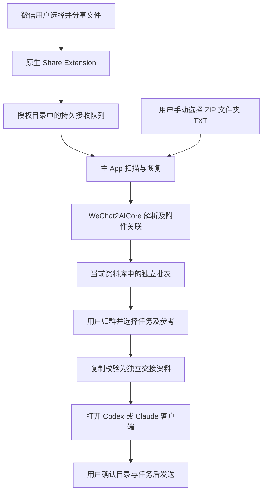

# 当前架构

适用版本：WeChat2AI v0.1.0 / build 1。

## 模块职责

| 目录或模块 | 职责 |
|---|---|
| `App/` | AppKit 生命周期、唯一 ObservableObject 模型、唯一 SwiftUI 主界面、原生系统面板与接收协调 |
| `ShareExtension/` | 沙盒内接收 NSItemProvider 文件，保存持久队列及目录授权书签 |
| `WeChat2AICore/Importer.swift`、`Transcript.swift`、`ZIP.swift` | 输入复制、解压、正文解析、附件关联、原文保留 |
| `Library.swift`、`LibraryStore.swift` | 资料库与批次、按群归档、文件锁、原子提交及中断恢复 |
| `IntakeQueue.swift`、`IntakeProcessor.swift` | 持久队列、幂等回执、失败恢复与 payload 清理 |
| `AgentWorkspace.swift`、`ManagedProjects.swift` | 当前产品的 Agent 数据目录、目录安全检查与固定群项目 |
| `HandoffPackage.swift`、`AnalysisTask.swift` | 独立资料副本、明确的参考范围、模板和输出策略 |
| `CodexHandoff.swift`、`ClaudeCodeHandoff.swift`、`ClaudeCoworkHandoff.swift` | 客户端深链、路径编码和任务预填 |
| `WeChat2AICLI/`、`CZlib/` | 独立命令行入口、系统 zlib 桥接 |

## 本地数据与可靠性

资料库以文件系统和 JSON 元信息为依据，不依赖数据库。每次导入生成独立批次；同名来源使用固定 ID 区分，重命名不改变目录名。写操作通过本机文件锁串行化，临时输出成功后提交；移动操作记录用于恢复。

归档可能改变原批次的路径，因此交接先生成独立副本并校验。外部 Agent 可以访问这个稳定目录；后续改归原批次不会移动副本。副本仍可被用户或外部程序修改，不是只读存储。

自动接收队列经历 `incoming → ready → processing → completed`，失败进入 `failed`。成功入库并写入回执后才清理接收 payload，重复通知依据队列身份和回执处理。手动导入的来源文件不被清理。

## 权限与边界

主 App 为本地开发用非沙盒应用，分享扩展启用 App Sandbox。扩展和宿主分别保存目录接入状态；当前不依赖 App Group。权限失效时报告错误并由用户重新连接，不静默新建替代资料库。

解压和复制拒绝路径越界、符号链接及特殊文件，并限制输入大小。解析无法识别时保留原文，不补造时间、群身份或消息。聊天正文与附件属于分析资料，不是用户指令。

本程序不调用模型，不自动发送任务。系统接受深链请求与目标 Agent 完成读取是不同验收项。详细结构见[数据格式](data-format.md)，当前约定见[产品约定](product-contract.md)。

## SwiftUI 主界面

应用直接使用 NSHostingView 承载唯一 SwiftUI 主窗口，由 `AppModel`、`AppOperations`、`IntakeCoordinator` 和 `AppEnvironment` 管理状态与操作。任务、参考、归档和接收管理由统一路由的 SwiftUI Sheet 承担；NSTextView 负责消息阅读排版、原文、选区复制与批内查找。原生面板负责文件/目录、来源编辑及删除确认，可显式指定发起窗口。设置是独立 SwiftUI 非模态窗口，与主窗口共用 AppModel 和操作锁。

状态和资料操作测试使用显式注入的临时路径与独立 UserDefaults suite；隔离 UI 宿主使用独立测试 Bundle ID。Share Extension 单独编译，WeChat2AICore 与 CLI 由 Swift Package 定义。隔离宿主必须带 `--ui-test-root`，缺失参数时直接退出，避免打开真实设置。详见[验证记录](validation.md)。

主窗口采用共享 Editorial Sandstone Theme、来源 / 批次 / 阅读三栏及固定交接台，三个 Agent 使用同一选择和交接路径。Sheet 由路由统一尺寸，已生成交接记录保留自己的任务、范围与副本路径。窗口与验证边界见[验证记录](validation.md)。

正文由后台读取同批 `transcript.md` 和 `messages.jsonl`，预览请求与批次身份核验后更新；无结构化消息时保留原文回退。只有依赖正文的动作等待预览，文件写入与面板仍统一互斥。附件定位先验证本批相对路径及常规文件，不执行聊天里的 URL。交接结果按资料库 ID / 批次 ID 存于内存，保留该次任务、结果时间与副本路径。

来源与批次仍由 SwiftUI 滚动列表绘制；每列用轻量 AppKit 键盘响应入口统一处理上下方向键，选择更新复用 AppModel，原生文本的键盘与查找仍交给 NSTextView。这样避免行按钮嵌套焦点与系统列表装饰叠加，不引入第二套主界面。

阅读视图的 `InlineImagePreview` 用 ImageIO 在后台校验和下采样本机图片，通过 NSTextAttachment 单元显示。正文滚动只触发视口附近的加载；离屏释放单元位图并保留几何尺寸，内存缓存受限。图片尺寸变化时按首个可见字符补偿滚动，图像结果以批次 / 路径 / 预览请求身份隔离；原文和“复制给 AI”使用批次保存的 Markdown。
