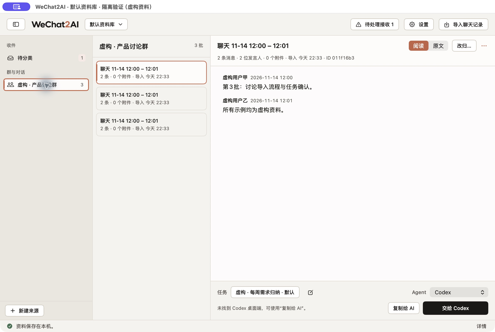
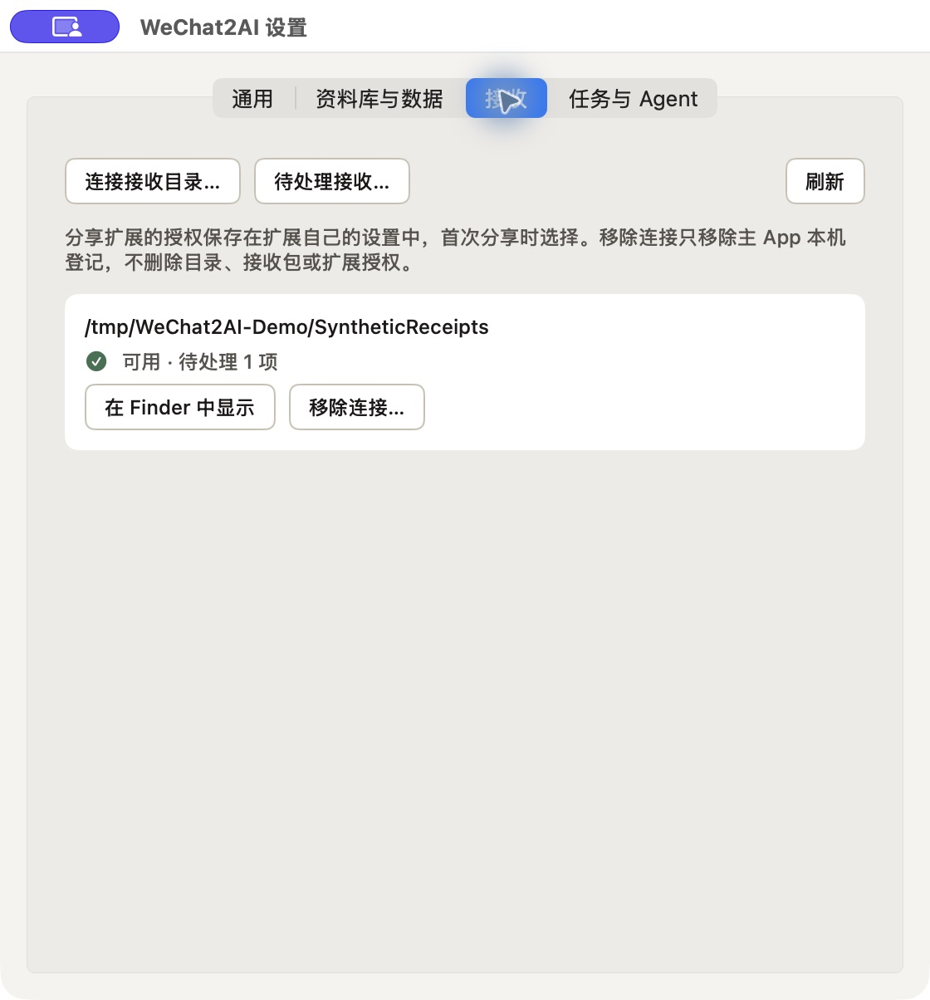
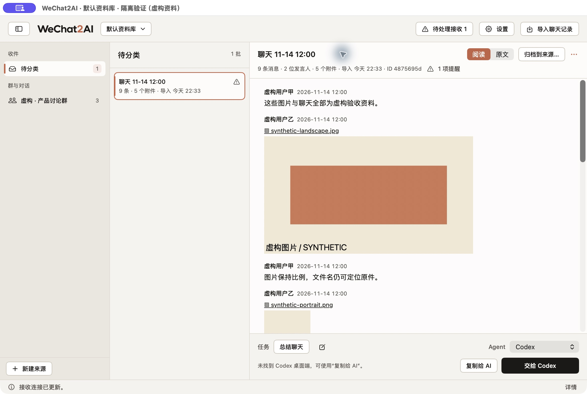
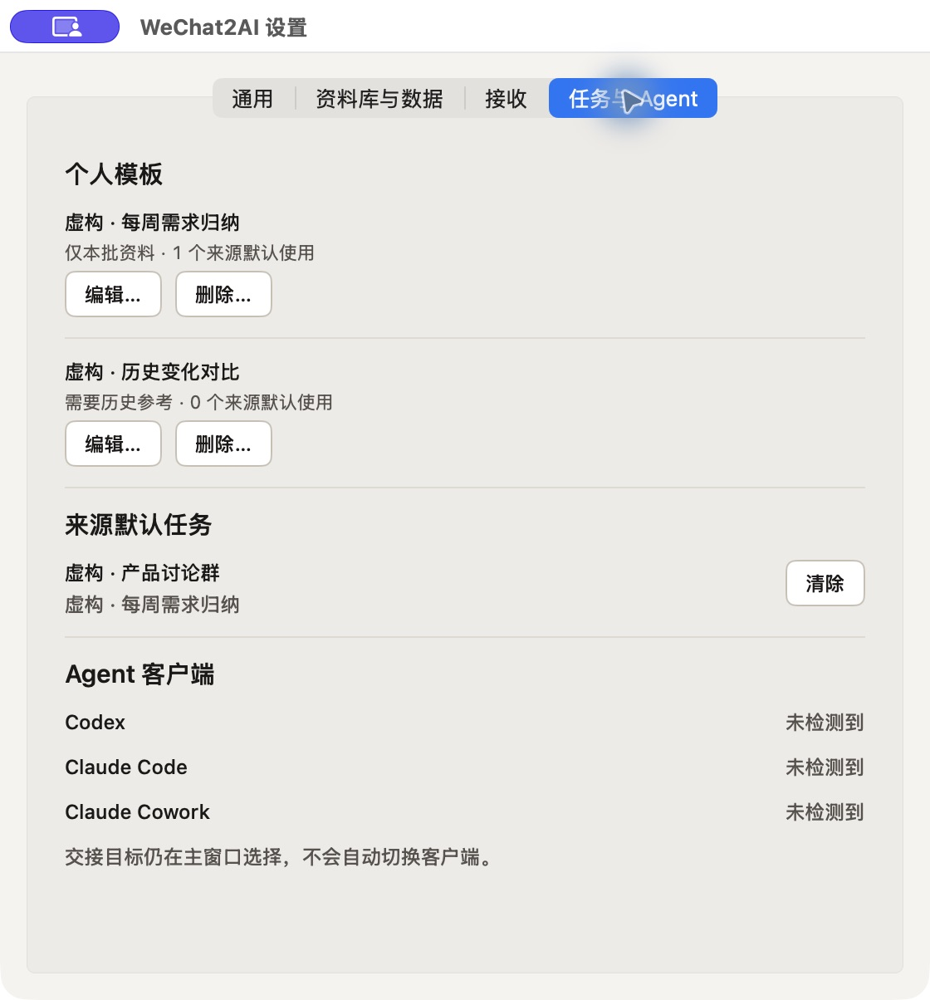
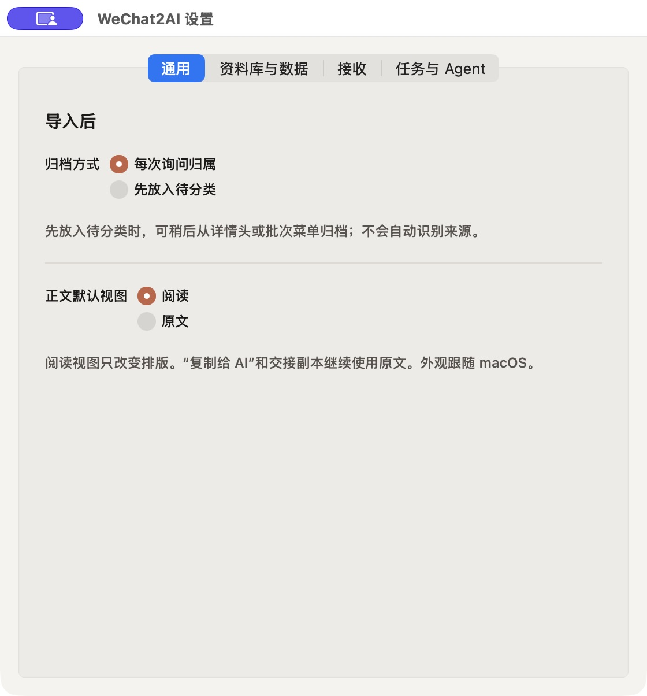
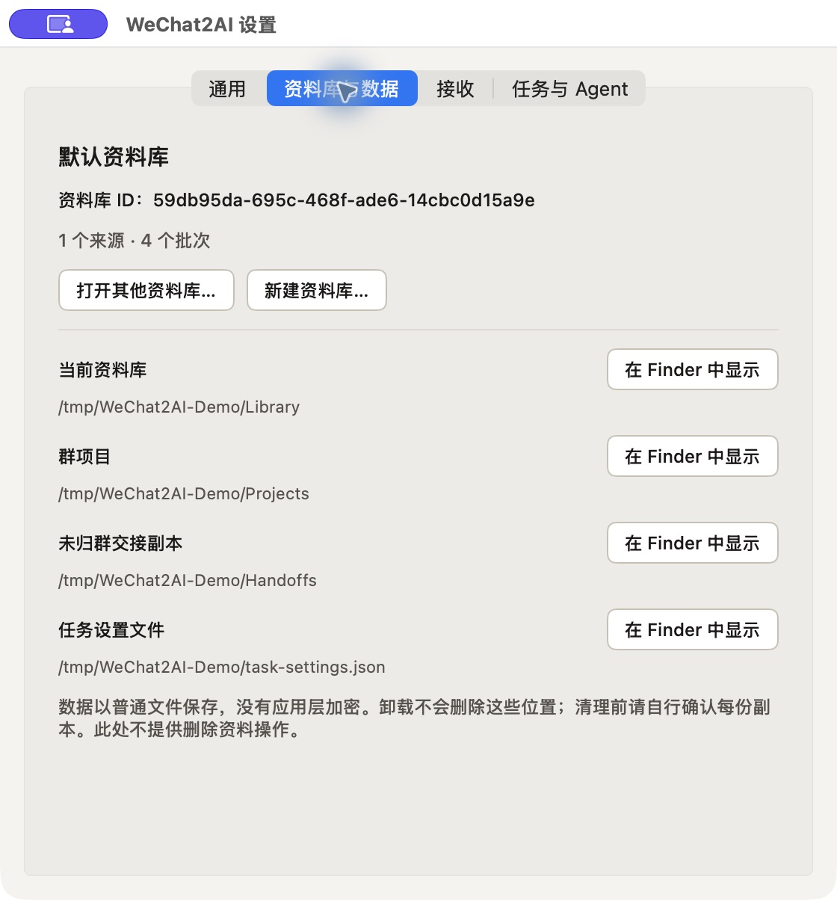

# WeChat2AI 普通用户安装与使用指南

适用版本：0.1.0 / build 1 · 更新日期：2026-11-14。

WeChat2AI 用来保存微信分享或手动导入的聊天资料，按群聊或私聊整理，再交给 Codex、Claude Code 或 Claude Cowork 分析。首次打开会自动建立默认资料库，不需要配置 API Key、数据库或数据路径。

本文截图全部来自隔离测试环境，聊天、模板、图片、接收任务和目录均为虚构示例。新安装的应用不会自带这些记录。

- [安装与首次打开](#安装与首次打开)
- [先用虚构样例试一遍](#先用虚构样例试一遍)
- [导入与归档聊天](#导入与归档聊天)
- [阅读正文和查看图片](#阅读正文和查看图片)
- [交给 AI 分析](#交给-ai-分析)
- [调整设置](#调整设置)
- [更新与备份](#更新与备份)
- [常见问题](#常见问题)

## 安装与首次打开

### 准备安装包

当前是开发预览版，尚无公开下载页或 Homebrew 安装命令。收到维护者提供的测试包后，按下面的步骤安装。

| 项目 | 当前要求 |
| --- | --- |
| Mac | 当前 `arm64` 安装包适用于 Apple Silicon，也就是 M 系列芯片；不要用于 Intel Mac |
| 系统 | 应用声明最低 macOS 13，目前只在 Apple Silicon / macOS 26 验证，其他系统组合尚未完成实机验收 |
| 开发工具 | 使用预编译 App 不需要 Xcode、Swift、Homebrew 或终端 |
| AI 客户端 | 仅在需要交给 AI 时安装对应客户端，并完成它自身的登录与文件访问授权；只导入和阅读时不需要 |

### 安装 App

1. 解压维护者提供的 `WeChat2AI-…-arm64.zip`。
2. 将里面的 **WeChat2AI.app** 拖到 Finder 的“应用程序”文件夹。
3. 从“应用程序”打开 WeChat2AI。分享扩展已包含在 App 内，不需要单独安装。

当前测试包未使用 Developer ID 签名，也未经过 Apple 公证。若 macOS 提示无法验证开发者或无法检查恶意软件，请先确认测试包来源；确认为可信来源后，可在尝试打开后进入“系统设置 → 隐私与安全”，按系统提供的“仍要打开”流程确认。若提示包含恶意软件、被策略禁止或没有该入口，请保留提示并联系维护者，不要关闭系统整体安全保护。步骤以 [Apple 的安全打开说明](https://support.apple.com/zh-cn/102445)为准。

### 首次打开后会发生什么

应用会自动创建默认资料库，显示空的“待分类”区域。无需手动选择目录；任务默认是“总结聊天”，Agent 默认是 Codex，正文默认使用“阅读”视图。

默认资料库位于 `~/Library/Application Support/WeChat2AI/Library/`。`~` 表示你自己的用户文件夹。Agent 的项目与交接副本会在第一次使用对应功能时按需创建。

图 1：浅色主窗口，内容区 1180 × 760，全部为虚构记录。左侧选择来源，中间选择一次导入批次，右侧阅读正文；底部选择任务和 Agent。窄窗口可能收起左侧列表，可通过左上角来源按钮或选择菜单切换。

## 先用虚构样例试一遍

不想立即使用真实聊天时，可以先保存项目提供的[虚构聊天样例](../Tests/Fixtures/text/聊天记录.txt)。在仓库网页中可下载该文件的原始内容，文件名保留为 `.txt`。

1. 点击右上角 **导入聊天记录**，选择保存的样例 TXT。
2. 导入完成后若出现“归档到来源”，先点击 **暂不归档**。
3. 在“待分类”选择新批次，样例应显示 3 条消息、2 位发言人，没有附件。
4. 切换“阅读 / 原文”，试着选择正文或使用 ⌘F 查找。
5. 如要体验 AI 交接，按后面的[交给 AI 分析](#交给-ai-分析)操作；没有 Agent 客户端也可以先阅读样例。

这份 TXT 只验证文字流程。指南中的图片和设置截图使用另外生成的虚构资料，导入该 TXT 不会出现截图里的图片、模板或待处理任务。

## 导入与归档聊天

### 手动导入文件

点击 **导入聊天记录**，一次选择一份输入：

| 输入 | 适合的情况 |
| --- | --- |
| 完整导出文件夹或 ZIP | 需要同时保存正文、图片和其他附件；保持导出文件的目录结构 |
| TXT | 只导入正文；不会自动复制 TXT 旁边的附件 |
| `.w2adrop` | 导入从分享流程另存的接收包 |

TXT 需要是可识别的聊天导出文本，任意纯文本不一定能拆分成消息。文件夹或 ZIP 中应只有一份可识别正文。暂不支持直接读取微信本机数据库、加密 ZIP 或 ZIP64；整个输入最多 512 MiB、10,000 项，正文 TXT 最多 20 MiB。

导入成功会保存独立批次。重复导入同一份文件会产生新批次，当前不会自动去重。

### 将记录归入群聊或私聊

“来源”表示一个群聊或私聊对话；“批次”表示一次导入。一个来源可以有多个批次，应用不会根据聊天内容自动判断所属群。

1. 在导入后的归档窗口选择已有来源，或点击 **新建来源…** 填写名称与类型。
2. 选择后点击 **归入…** 确认。
3. 暂时无法确定时，点击 **暂不归档**，记录仍已保存在“待分类”。之后选择批次，再点击详情头的 **归档到来源…**。

归档只改变这批记录的归属，不会移动此前已经交给 Agent 的独立副本。也可以不归档，直接对待分类批次选择任务。

### 从微信直接分享

这条路线取决于微信版本提供的系统分享入口；当前开发版本的真实微信分享流程仍待完整回归。若找不到入口，可先使用手动导入。

1. 在微信选择需要的消息，使用合并转发，再寻找 **转发到其他应用 → WeChat2AI**。
2. 首次分享会要求选择接收位置。选择本机一个稳定保存的目录，扩展会在其中创建 `WeChat2AI Receipts` 接收文件夹；以后也可选择这个已有文件夹。
3. 分享完成后，主 App 首次会询问是否连接该接收目录。点击 **连接并导入**。
4. 后续分享复用该连接，主 App 按接收队列自动入库。成功入库后清理的是接收暂存副本，资料库中的原文和附件会保留。

如果分享列表没有 WeChat2AI，可在系统分享菜单的“编辑扩展…”中查找并启用；不同 macOS 版本的入口名称可能不同。仍未出现时，先确认 App 已放入“应用程序”并打开过，再联系维护者。

图 2：设置中的“接收”页。图中的 `SyntheticReceipts` 和 1 项任务均为虚构；它们不是你需要照填的目录或正常使用必须保留的任务。

**连接接收目录…** 可重新登记已有接收目录。扩展的目录授权仍须在首次分享时完成，不能仅靠主 App 的连接按钮代替。

## 阅读正文和查看图片

选择一个批次后，右侧可切换：

- **阅读**：按发言人、时间和消息排版；可查找、选择和复制正文。
- **原文**：查看保存的 Markdown 文本，适合核对解析结果；没有可用结构化消息时会保留原文回退。

图 3：图片预览示例，聊天及色块图片均为自制虚构数据。

当导入包确实带有图片附件时，阅读视图会在文件名下面显示本机缩略图；点击文件名可在 Finder 定位原件。只有文件名、未附原图的记录无法还原图片。损坏、不支持或超限的图片会显示说明，其他正文仍可阅读。

目前不提供图片点击放大、视频播放、PDF 内联预览或 OCR。阅读区显示缩略图，也不代表图片已经交给 AI 识别。

## 交给 AI 分析

### 选择任务与客户端

1. 选中需要分析的批次。
2. 在底部“任务”菜单选择 **总结聊天**、**提取待办**、**整理产品需求** 等任务。先体验时可保持“总结聊天”。
3. 在 **Agent** 中选择 Codex、Claude Code 或 Claude Cowork。Code 与 Cowork 都通过对应 Claude 桌面客户端打开；客户端是否支持该入口，以它的版本和账号为准。
4. 点击对应的 **交给 Codex**、**交给 Claude Code** 或 **交给 Claude Cowork**。应用会准备独立资料副本，再请求打开对应客户端。
5. 在目标客户端确认文件夹、资料范围和任务；需要文件访问权限时，在该客户端确认，最后由你发送任务。

“已请求打开”只说明打开请求已发出，不代表 AI 已读取、开始分析或生成结果。当前三个 Agent 的完整真实环境交接仍待回归，遇到打开失败时可改用下面的复制方式。

### 没有检测到客户端

先安装并打开所需客户端，完成它自身的登录，再返回 WeChat2AI 查看“设置 → 任务与 Agent”中的检测状态。主窗口需要手动选中目标，应用不会因为检测到另一个客户端就自动切换。

也可点击 **复制给 AI**，把内容粘贴到自己使用的 AI 工具中。普通任务复制正文和要求；历史分析任务会先准备所选资料副本，再复制任务与路径。其他 AI 若无法访问你电脑上的路径，需要你自行附加文件。

复制不会把图片字节一起放进剪贴板。需要识图时，单独附加图片，或在支持本机文件访问的 Agent 中明确授权读取。

### 个人模板与历史参考

在任务菜单选择 **编辑任务要求…**，填写要求后可保存为个人模板；也可将任务设为当前来源的默认。已有模板从“设置 → 任务与 Agent”编辑或删除。

例如可填写：“整理本次讨论的待办，列出事项、负责人和截止时间；原文没说的字段写未明确，并附发言依据。”

图 4：模板与客户端状态示例。两个模板均为虚构；隔离宿主故意显示“未检测到”，不代表你自己的电脑没有安装客户端。

**对比新增变化** 需要先归档到来源，并选择至少一个同来源的其他批次。**更新项目结论** 可以选择同来源批次和已有成果。参考默认不选；交接时会出现“选择参考资料”窗口，请核对勾选项后再继续，应用不会自动把整个群历史送给 AI。

## 调整设置

点击右上角齿轮 **设置**，或按 ⌘,。初次使用可以保持默认，不必逐页配置。

| 设置页 | 可以调整或查看什么 |
| --- | --- |
| 通用 | 导入后每次询问归属，或先放入待分类；正文使用阅读或原文视图 |
| 资料库与数据 | 查看真实保存位置、在 Finder 显示、新建或打开其他资料库 |
| 接收 | 查看接收连接、待处理任务及连接错误 |
| 任务与 Agent | 管理个人模板、清除来源默认任务、查看客户端是否被检测到 |

图 5：默认选项是“每次询问归属”和“阅读”。若不想导入后弹出归档窗口，可改为“先放入待分类”。外观跟随 macOS，无需另配主题。

### 查看和选择数据位置

图 6：数据位置示例。图中 `/tmp/…` 是截图专用临时目录，实际使用请查看自己设置页中的路径，不要照图创建。

默认保存位置如下：

| 内容 | 默认位置 |
| --- | --- |
| 资料库 | `~/Library/Application Support/WeChat2AI/Library/` |
| 个人模板与来源默认 | `~/Library/Application Support/WeChat2AI/task-settings.json`，首次保存设置时写入 |
| 已归群的 Agent 项目 | `~/WeChat2AI/Projects/`，按需创建 |
| 未归群交接副本 | `~/WeChat2AI/Handoffs/`，按需创建 |

“打开其他资料库”只切换打开位置，“新建资料库”只建立新库，**都不会移动已保存的资料**。移动或重命名当前库前先退出 App；位置改变后，需要重新打开正确的资料库。路径失效时，应用会提示问题，不会悄悄创建一个空库替代已保存的资料。

接收页的“移除连接”只移除主 App 的登记，不删除目录、接收包，也不撤销分享扩展的目录授权。清理文件与解除连接是不同操作。

## 更新与备份

### 更新 App

收到新测试包后，先退出 WeChat2AI，备份被替换的 App，再用新 App 替换原安装位置。使用时保留一份有效安装，避免同一标识的多个 App 影响分享入口。

应用与资料分开保存，替换 App 不需要重新导入记录。重要资料仍建议先备份；若新版本有额外升级步骤，以该版本说明为准。

### 备份自己的资料

退出 App 后，从“资料库与数据”记录的位置备份当前资料库、任务设置和需要保留的 Agent 项目 / 交接副本。使用默认位置时，可备份整个 `~/Library/Application Support/WeChat2AI/` 与 `~/WeChat2AI/`；如果自选过资料库，还要备份对应目录。

备份资料文件不等于备份所有系统偏好和授权。更换电脑后，分享目录连接和外部客户端文件权限可能需要重新确认。

卸载 App 不会自动删除聊天、附件、交接副本、成果或备份。删除原批次也不会删除此前交给 Agent 的其他副本。更多说明见[隐私与本地数据](../PRIVACY.md)。

## 常见问题

| 遇到的问题 | 可以先这样处理 |
| --- | --- |
| 打开应用后没有示例记录 | 正常，新安装默认是空资料库；可先导入本文的虚构 TXT |
| 导入后找不到刚才的记录 | 先查看“待分类”；若已归档，选择对应来源，再选批次 |
| 图片只显示文件名或提示缺失 | 确认导入了带附件的完整文件夹或 ZIP；只有 TXT 无法恢复原图，可重新导入完整导出 |
| 正文排版异常或有未解析提醒 | 切到“原文”核对；保留原始导出，用虚构或脱敏样例向维护者反馈 |
| 待处理接收一直存在 | 在“接收 → 待处理接收…”查看状态；接收尚未完成时先等待，失败后按提示重试；另存或丢弃前确认是否仍需保留原包 |
| 资料库暂不可用 | 检查磁盘连接和保存路径，再重新读取或打开原资料库，不要用新空库覆盖旧资料 |
| Agent 没打开或没读到文件 | 确认客户端已安装、主窗口选对目标，在客户端检查文件权限；必要时改用复制并自行附加文件 |
| 按钮暂时不能点击 | 等待当前导入或读取结束，或先关闭文件面板 / 弹窗，再继续操作 |

普通问题请提供 App 版本、macOS 版本、芯片类型、操作步骤与脱敏提示；不要在公开问题中上传真实聊天、附件、账号或私人路径。安全漏洞按[安全报告说明](../SECURITY.md)处理。

## 常用快捷键

| 操作 | 快捷键 |
| --- | --- |
| 设置 | ⌘, |
| 当前批次查找 | ⌘F |
| 阅读 / 原文 | ⌘1 / ⌘2 |
| 编辑任务要求 | ⌘T |
| 复制给 AI | ⇧⌘C |
| 交给当前 Agent | ⌘↩ |

应用不内置云端 AI 分析，也不自动发送任务。本机资料没有应用层加密；交给外部 Agent 后的处理取决于该客户端、账号和权限。完整的功能与验证边界见[README](../README.md)及[验证记录](validation.md)。
